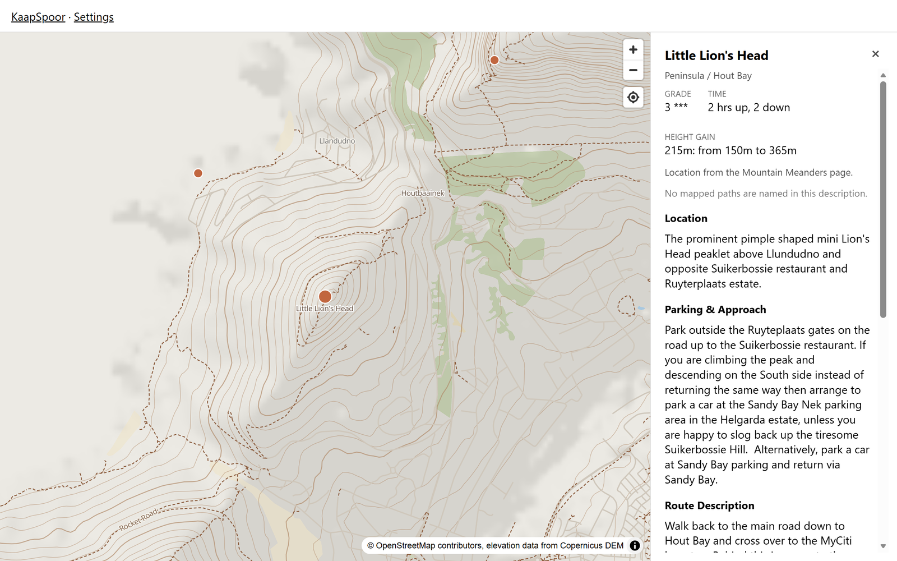
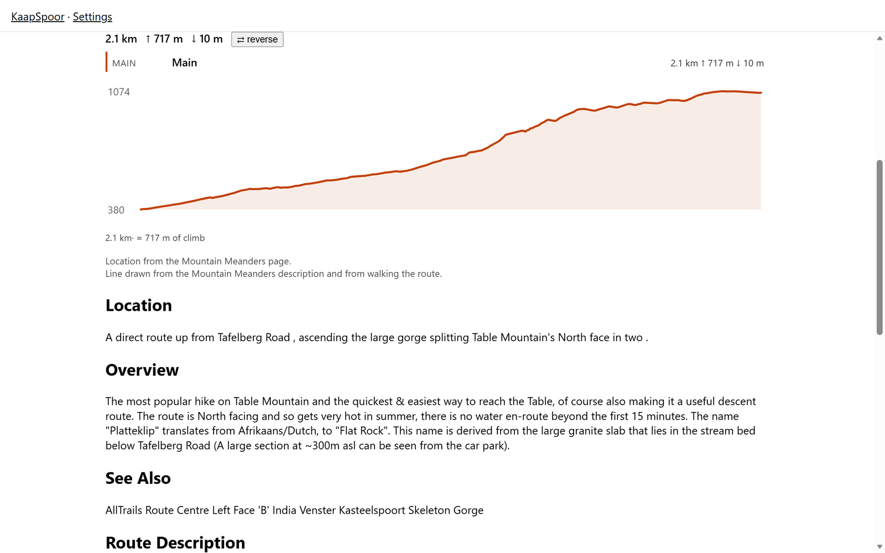
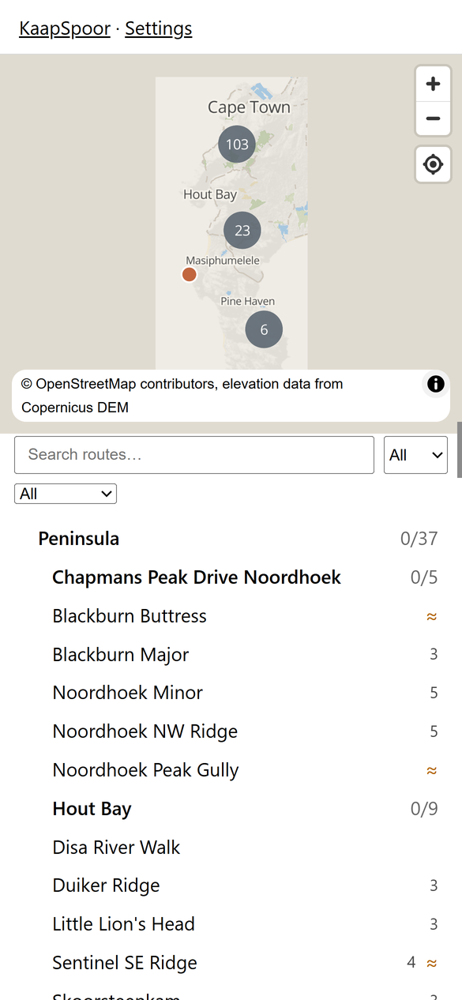

# KaapSpoor

**A hiking app for the Western Cape, built to stay open on the trail, not just while planning.**
Every niche route, written up by people who've walked it, on a map built to work with no signal.

> **Status:** in active development. The early web preview is live at
> **[britishtable.github.io/KaapSpoor](https://britishtable.github.io/KaapSpoor/)**: the 133 routes around
> Cape Town (184 catalogued across the Western Cape). Accounts, offline maps and Android/iOS builds are in progress for Release 1.

<p align="center">
  
</p>
<p align="center">
  
  
</p>

## Why this exists

Western Cape hikers already have two options, and neither works on the mountain:

- **Mountain Meanders** is the best route knowledge in the region, but it's a wiki. You read it
  the night before, not halfway up a ravine with one bar of signal.
- **AllTrails** misses the niche routes, its descriptions are thin, and there's no local community.

KaapSpoor's edge is **regional depth**: every route, written by people who've walked it, on a map
you can trust in the field, with patchy signal, harsh sun, one free hand and a battery to protect.

## What it does today

- **Route library**: 184 routes catalogued from 25 areas, with the 133 around Cape Town live in the
  preview. Grouped by area, searchable, and filterable by whether you've done them and whether
  they've been placed on the map yet.
- **Map built for hiking**: vector map with contours and hillshade, drawn route lines and named
  paths, served as PMTiles from static hosting.
- **Route pages** with grade, time, height gain, a locator map and the full route write-up.
- **Drawn route lines with elevation profiles**: distance, climb and a scrubbable profile from
  Copernicus elevation data. The first routes are drawn from the descriptions and from walking them.
- **Trail journal**: mark routes to-do or done on the device; export, import and merge your journal.

## Product decisions

- **Safety is never paywalled.** Live position, reports and check-ins stay free; premium is for
  app capabilities (planner, stats, GPX), never for route content.
- **Open content stays open.** Route text comes from Mountain Meanders under CC BY-SA 2.5 ZA,
  so it stays free, unaltered and attributed. One private landowner's email in the source was
  redacted, because republishing it in a bulk dataset is a different exposure from one line on a wiki.
- **Privacy by default.** No public live location and no public planned hikes, ever. Location
  history is personal information under POPIA, so export and deletion are launch requirements.
- **One front end, three platforms.** The SvelteKit app will be wrapped with Capacitor for Android
  and iOS instead of rewriting natively. A background-GPS spike was built first to check this holds up.
- **Releases ordered by obligation, not effort.** Features that make heavy promises (like
  check-in alerts to emergency contacts) ship last, once the platform is proven.

## Architecture

```
            ┌─────────────── one SvelteKit front end (app/) ───────────────┐
            │  web build → static host      Capacitor shells → Android/iOS │
            └───────┬───────────────────────────────────────┬──────────────┘
   static content   │  route index, pages, tiles             │  user data (JSON/HTTPS)
   (CC BY-SA, free) ▼                                        ▼
        static hosting + tile downloads            server/ (Spring Boot, Java 21)
                                                     PostgreSQL 16 + PostGIS
```

| Part | Stack | What it does |
|---|---|---|
| `app/` | SvelteKit, TypeScript, MapLibre GL, PMTiles | The app: map, route pages, profiles, journal |
| `server/` | Spring Boot 3.5, Java 21, PostgreSQL + PostGIS, Flyway | Accounts and user data. Google and Apple sign-in with verified-email account linking, JWT sessions |
| `server/openapi.json` | OpenAPI 3 | The API contract. The app's typed client is generated from it, and CI fails if they drift |
| `tools/scraper/` | Python | Crawls the Mountain Meanders wiki into `data/routes.json` |
| `tools/geocode/`, `tools/routelines/`, `tools/pathnames/` | Python, Node | Place routes on the map: geocoding, route geometry, OSM path names |
| `tools/tiles/` | Shell, GDAL | Builds the contour, hillshade and trail tile layers |

## Running it locally

**App** (Node 20+):

```sh
cd app
npm ci
npm run dev        # builds the route data, then starts Vite
```

**Server** (JDK 21 and Docker; tests use Testcontainers with PostGIS):

```sh
cd server
./mvnw verify
```

Production configuration is documented in [`server/README.md`](server/README.md).

## Testing and CI

- **App:** Vitest unit tests, `svelte-check`, and Playwright end-to-end tests (also run under the
  GitHub Pages sub-path).
- **Server:** integration tests against a real PostGIS container. `OpenApiSnapshotTest` fails if the
  live API differs from the committed contract.
- **CI:** GitHub Actions regenerates the API client and fails on any diff, runs the test suites,
  and deploys the web build to GitHub Pages.

## Roadmap

| Release | Focus |
|---|---|
| 1 | On-trail app: accounts, live position on route, offline maps, reviews, day-level reports, trail history |
| 2 | Social: friends, private planned hikes, privacy zones |
| 3 | Conditions: wind, fire danger and closures, tides, sunset vs. finish time |
| 4 | Premium: route planner, stats, time estimates, GPX export |
| 5 | Check-in: expected-return alerts with graded escalation |
| 6 | Completion lists and opt-in GPS tracks to map unmapped routes |

Coverage starts with Cape Town and grows across the Western Cape.

## Data and licence

Route data in [`data/`](data/) comes from the
[Mountain Meanders wiki](https://sites.google.com/site/mountainmeanderswiki/Home) and is licensed
**CC BY-SA 2.5 ZA** (see [`data/LICENSE`](data/LICENSE)). Map data © OpenStreetMap contributors;
elevation data from Copernicus.

---

Built by **Keegan Joubert** · [GitHub](https://github.com/britishtable)
